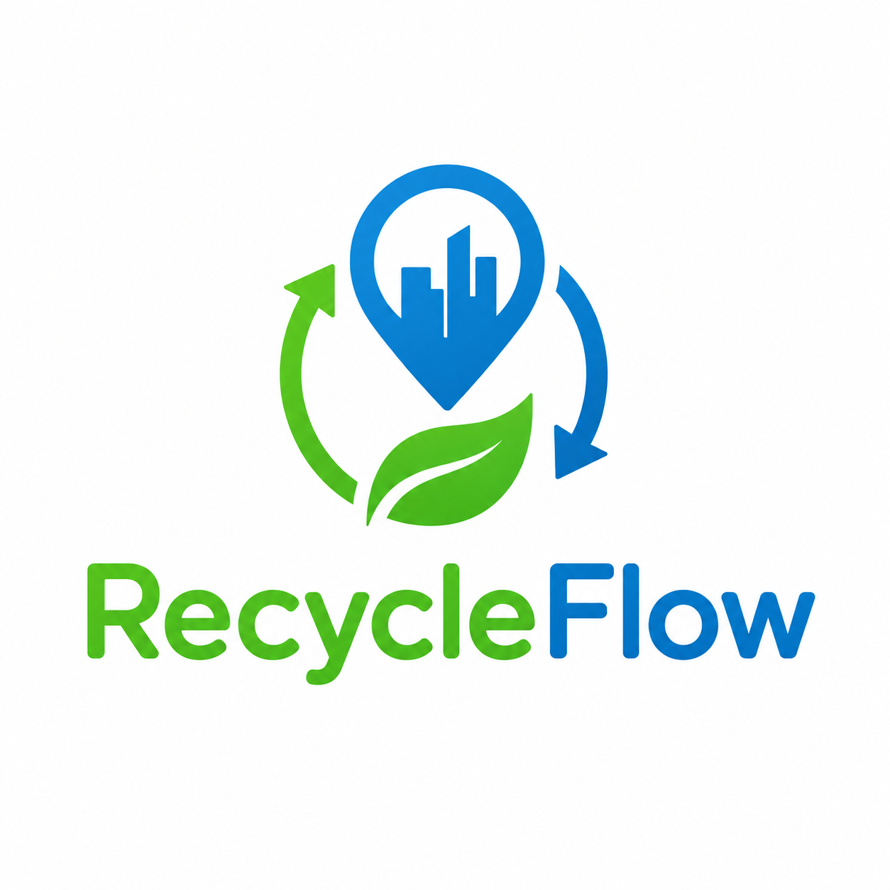

<div align="center">
  

  Sistema de apoio à Reciclagem Urbana
</div>


O RecycleFlow é uma plataforma em desenvolvimento para centralizar informações sobre reciclagem e descarte correto de resíduos em Rio Claro (SP) e região. Seu objetivo é ajudar as pessoas a identificar como preparar materiais para o descarte e onde encontrar pontos de coleta adequados.

Status:
Projeto acadêmico em desenvolvimento, com banco de dados estruturado e rotas iniciais de consulta implementadas.

## Jogo de separação

O jogo fica em `/jogo` e ensina, de forma lúdica, para onde vai cada tipo de resíduo. O jogador
arrasta um material de cada vez até o destino correto:

| Destino | Material |
|---|---|
| Lixeira azul | Papel |
| Lixeira vermelha | Plástico |
| Lixeira verde | Vidro |
| Lixeira amarela | Metal |
| Lixeira marrom | Orgânico |
| Ecoponto | Resíduos que não vão para a coleta seletiva comum (ex.: bitucas de cigarro) |

Cada acerto vale 10 pontos e, certo ou errado, o jogo mostra uma dica de descarte sobre o material.
Quando o destino correto é o Ecoponto, aparece um atalho para o mapa de pontos de coleta. Ao final,
o jogador vê a pontuação e pode jogar de novo ou ir direto ao mapa.

O jogo funciona só no frontend, sem chamadas à API. Os materiais, destinos e dicas ficam em
`frontend/src/data/game.js` e as imagens em `frontend/public/assets/game/`; para incluir um novo
material, basta acrescentar um item à lista `MATERIAIS` com a imagem correspondente.

O acesso é feito pelo card do jogo na Home, pelas chamadas nas páginas de Materiais e Conteúdos
(componente `GameBanner`) e pelo link "Jogo da separação" no rodapé.

## Área administrativa

O painel fica em `/admin`. As operações de criação, edição e remoção são protegidas no backend:
instituições, pontos de coleta e materiais são desativados logicamente; projetos e conteúdos
educativos podem ser excluídos. Projetos e artigos/dicas só aparecem nas rotas públicas quando
marcados como publicados.

Configure `ADMIN_TOKEN_SECRET` no ambiente do backend com pelo menos 32 caracteres aleatórios.
Por exemplo, gere um valor com `python -c "import secrets; print(secrets.token_urlsafe(48))"`.
Não reutilize nem publique esse segredo.

Não há cadastro público de administradores. Para criar a primeira conta, configure a variável
`URL` do banco Neon como já é feito para a API e execute no diretório `backend`:

```powershell
python -m scripts.create_admin
```

O comando solicita nome, e-mail e senha de forma interativa e grava apenas o hash Argon2id da senha.
Cada requisição administrativa verifica novamente se a conta continua ativa e com papel `admin`,
de modo que o acesso possa ser revogado alterando `usuario.papel` ou `usuario.ativo` no banco.

Os endpoints de administração ficam sob `/admin`. Os registros públicos existentes usam as tabelas
do schema atual; aplique `backend/db/schema.sql` e as migrações já existentes antes de ativar o
painel em um banco ainda não preparado.